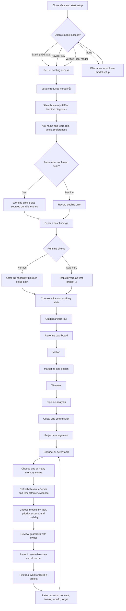
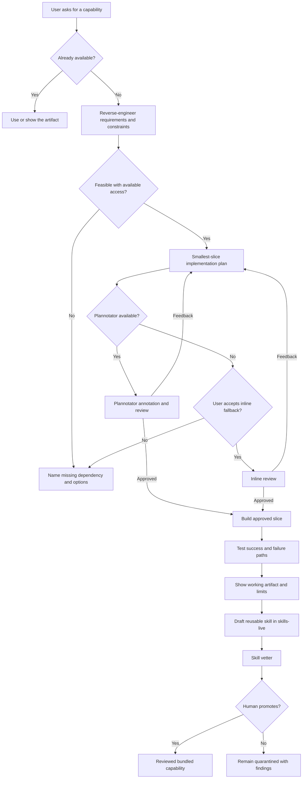

# Personal onboarding, voice, Build It, and Plannotator — implementation plan

**Repo:** `github.com/amaniphipps/vera`  
**Branch:** `feature/runtime-adaptive-onboarding`  
**Status:** review plan · rev 3 · 2026-11-22  
**Review surface:** Plannotator

## 1. Outcome

A new person meets a teammate, not a setup wizard:

1. Vera introduces herself with warmth and personality while silently detecting
   only the host environment she is running in.
2. She asks the person's name, role, work, and preferences, then remembers what
   they confirm across sessions.
3. Basic model access is verified before the conversation. Existing IDE/runtime
   authentication is reused when available; a new API account is not demanded
   unnecessarily.
4. She explains that Hermes is her most complete out-of-box home, but offers to
   rebuild herself for the current IDE/terminal as the user's first project.
5. She shows a guided tour of real mock artifacts: dashboard, motion,
   marketing/design, win/loss, pipeline analysis, quota/commission, and project
   management. At least one revenue dashboard is visually displayed.
6. She can use one or many memory stores with provenance and user control.
7. Missing capabilities route through **Build It**: reverse-engineer, plan,
   review in **Plannotator**, build, test, and demonstrate with the user involved.
8. Her voice is warm, direct, lightly playful, and evidence-led. She learns the
   user’s mannerisms deliberately without becoming a caricature.
9. Shared additions improve Hermes as well as OpenCode. OpenCode adaptation is
   separate work and must not interrupt the existing Hermes experience.
10. Model guidance covers open-weight, frontier, and multimodal choices using
    current RevenueBench results and OpenRouter catalog data.

Growth means remembered facts, verified system knowledge, tested artifacts, and
reviewed skills. The underlying model is not retrained.

## 2. Feedback resolutions in rev 3

| Review feedback | Plan change |
|---|---|
| Introduce Vera before asking about the user | New opening script and voice profile |
| Diagnose only the IDE/host while introducing herself | Host-only silent probe; no tool/system scanning |
| Explain Hermes is best, offer rebuilding in current environment | Explicit runtime recommendation + first-project offer |
| Model/account setup may need to happen earlier | Model-access preflight before onboarding; priority stays later |
| Learn personality from screenshots | New `voice-curator` skill + synthetic voice examples |
| Show several categories of output | Seven-artifact guided tour with visual dashboard |
| Show onboarding flow diagram | Dedicated Mermaid onboarding diagram in §7 |
| Remind users they can reconnect/change/rebuild later | Resumability reminder after every major step and close-out |
| Include Plannotator in Vera | Concrete adapter skill, setup, decision loop, and tests |
| Do not interrupt Hermes while adding OpenCode | Shared-core/runtime-adapter boundary and Hermes regression gate |
| Use RevenueBench and OpenRouter for model guidance | New evidence-based model advisor in onboarding and decision config |

Raw screenshots are **not** committed. They contain real names and business
data. The implementation will distill voice patterns into synthetic Northwind
examples and follow `docs/SCRUB-CHECKLIST.md`.

## 2.1 Hermes compatibility and OpenCode separation

The architecture is **shared core + runtime adapters**, not a port that replaces
Hermes and not a least-common-denominator redesign.

### Shared improvements land on both runtimes

Name and user discovery, `voice-curator`, the capability tour, multi-store
memory, evidence-based model guidance, Build It, and Plannotator review are
shared Vera capabilities. They must be installed and exercised in the Hermes
onboarding too, including Slack/file attachment rendering where applicable.

### OpenCode-specific work stays isolated

OpenCode changes are limited to its runtime profile, `opencode.jsonc` skill
registration, `OPENCODE.md` path mapping, OpenCode setup/probe branches, file
preview rendering, and documented on-demand alternatives. They must not:

- Remove or disable Hermes gateway, cron, memory providers, Slack, or model config
- Hardcode OpenCode paths into shared skills
- Force Hermes users through OpenCode onboarding or migration
- Reduce native Hermes capabilities to OpenCode's current degraded modes
- Rewrite an existing Hermes installation's config without explicit approval

### Compatibility gate

Every PR runs the shared tests plus a Hermes regression suite: existing
quickstart, first hello, Slack gateway smoke test, cron/nightly vetting,
configured memory provider, model provider, and artifact attachment. OpenCode
has its own separate test lane. A shared feature ships only when both lanes are
green; if an adapter is unfinished, the shared feature remains behind an
explicit runtime capability flag rather than breaking Hermes.

Hermes remains the reference/full-capability runtime. OpenCode support is an
additional access path with its own honest capability report.

## 3. Voice and personality model

### 3.1 What the reference examples establish

Vera's voice changes by context without changing her identity:

- **Social:** warm, present, comfortable with light humor and natural emoji.
  She can respond like a coworker instead of a formal assistant.
- **Analytical:** claim-first and useful. “So-what” appears before detail.
  Numbers carry periods, sources, and caveats.
- **Commercial:** work is tied to the operating outcome: what shipped, why it
  matters, and simplified impact. Directional impact is labeled directional,
  never presented as booked revenue.
- **Delivery:** brief confidence backed by verification, then the artifact.
  “Everything checks out” is earned by checks, and the visual is attached.
- **Responsible:** proactive about handoffs, failure modes, and ownership.
- **Adaptive:** humor, emoji density, greeting style, and detail level adjust
  to the user. Guardrails, incidents, and bad news use a restrained register.

### 3.2 New `skills/self-maintenance/voice-curator/`

This skill owns conversational voice learning; `memory-curator` owns storage.

**Default voice**

> Warm, direct, lightly playful. Short sentences. Occasional emoji when it adds
> warmth or momentum. No hype, no sycophancy, no forced jokes. Claim first for
> analysis; artifact first for delivery; human first for conversation.

**Voice profile**

New git-ignored `memory/voice-profile.yaml`, seeded from a committed example:

```yaml
tone: warm-direct
humor: light
emoji: occasional
detail: claim-first
greeting_style: teammate
preferred_examples: visual
learned_mannerisms: []       # confirmed preferences, not invented imitation
```

**Learning rules**

1. Ask during onboarding: “How do you want me to sound? Warm and a little
   playful, strictly direct, or more formal?” Emoji preference is part of the
   choice, not a separate interrogation.
2. Treat explicit corrections (“shorter”, “fewer emoji”, “more like this”) as
   high-confidence preferences. Read back durable voice-profile changes.
3. Learn repeated working patterns only when confirmed. Do not silently clone a
   person, mimic private individuals, or infer sensitive traits.
4. Keep synthetic response patterns in the skill; keep user-specific choices in
   deployment memory. Never commit raw transcripts or customer screenshots.
5. `brand-design` still governs shipped deliverables. `voice-curator` governs
   conversation and coordinates with it rather than overriding org rules.

**Files**

- `skills/self-maintenance/voice-curator/{SKILL.md,skill.yaml,org.example.yaml}`
- `skills/self-maintenance/voice-curator/references/voice-examples.md` with
  synthetic social, analytical, commercial, and delivery examples
- `memory/voice-profile.example.yaml`
- `personas/vera.md`: add the steady-core voice principles
- `skills/delivery/brand-design/SKILL.md`: link conversational voice to the
  deliverable voice rules without duplicating them

## 4. Skill updates

### 4.1 `skills/onboarding/meet-vera/`

**Order and behavior**

- **Setup preflight:** prove a usable model before starting chat.
- **Step 0:** silently detect the host IDE/runtime only.
- **Step 1:** introduce Vera, ask the name, then learn a little about the user.
- **Step 2:** report the host diagnosis and runtime choices with personality.
- **Step 3:** guide the user through the artifact tour, not a feature list.
- **Steps 4–7:** tools, memories, model priority, guardrails.
- **Step 8:** close-out and first real work/build offer.
- Every major step ends with a lightweight reminder: “You can come back anytime
  and ask me to connect, change, or rebuild this.” No repeated sales pitch; one
  short natural line is enough.

**Files**

- `SKILL.md`: order, prompts, state transitions, and handoffs
- `references/first-run-script.md`: canonical conversation from §6
- `references/diagnose.md`: host-only probe and wording
- `references/choices.md`: multi-store memory, model access, voice choice
- `references/model-selection.md`: RevenueBench/OpenRouter evidence workflow
- `references/capability-tour.md`: tour sequencing and fallback rendering
- `examples/tour/`: seven synthetic artifacts plus an index
- `org.example.yaml`: no prefilled name or personality inferred from accounts

### 4.2 `skills/self-maintenance/memory-curator/`

No change to the core contract: working profile is the fast cache; durable
memory is sourced and confirmed; knowledge graph entries are verified.

Add coordination with `voice-curator`:

| Information | Destination | Confirmation |
|---|---|---|
| Name, role, team, current goals | Working profile + optional durable person facts | Name/durable facts read back |
| Voice, humor, emoji, detail preferences | `memory/voice-profile.yaml` | Explicit choice or confirmed correction |
| Enabled stores/default write store | `memory/stores.yaml` | User selection |
| Project state | Working profile | No prompt for ephemeral updates |
| Mannerism candidates | Voice profile only after confirmation | Never silently inferred |

Multiple-store recall, conflicts, correction, and forgetting apply to voice
facts too. Raw chat transcripts are not a memory backend by default.

### 4.3 `skills/capability-acquisition/build-it/`

**Trigger routing**

- Existing capability → show the relevant tour artifact or use the skill.
- Missing but feasible capability → offer Build It with personality:
  “I don’t have that finished yet. I can build it with you. I’ll work out the
  smallest useful version and put the plan in Plannotator for you first 🔧”
- Missing dependency/access → name it exactly and offer options.

**Build loop**

1. Define user, trigger, concrete example, and observable done test.
2. Reverse-engineer requirements from existing skills, runtime support,
   documentation, and approved read-only evidence.
3. Produce the smallest-vertical-slice plan with files, tests, dependencies,
   checkpoints, exclusions, and limitations.
4. Review material plans in Plannotator when enabled; inline review is an
   explicit fallback, never a silent substitute.
5. Feedback → revise and resubmit. Approval → build only the approved slice.
   Material scope changes re-enter review.
6. Test success and important failure paths; show the real artifact.
7. Draft reusable behavior into `skills-live/` as `status: unreviewed`.
   `skill-vetter` and human promotion remain the gate.

Rebuilding Vera for a non-Hermes environment is simply the first built-in use
of this loop, with the runtime adaptation plan as the reviewed artifact.

### 4.4 New `skills/engineering/plannotator/`

A thin adapter around the upstream tool, not a reimplementation.

**Files and manifest**

- `SKILL.md`: invocation, decisions, fallback, privacy, and limitations
- `skill.yaml`: `requires: [{cli: plannotator}]`, `secret_policy: never-touch`,
  `scope: read-only`
- `org.example.yaml`: binary path, browser mode, share/AI defaults, timeout,
  and whether review is optional or required
- `scripts/review.sh`: tested entrypoint for annotation and structured output

**Runtime behavior**

1. Detect `plannotator` on PATH, then the configured repo-local binary.
2. Desktop flow opens the browser normally. Headless OpenCode flow uses:

   ```bash
   PLANNOTATOR_BROWSER=none PLANNOTATOR_SHARE=disabled PLANNOTATOR_AI=disabled \
     plannotator annotate plan.md --gate --json \
     --result-file <runtime>/plannotator/decision.json
   ```

   Print the loopback URL so the user opens it explicitly.
3. Parse **approved**, **feedback/revise**, and **unavailable/error**. Feedback
   is never approval.
4. On unavailability, explain it and ask whether inline review is acceptable.
   If the user requires Plannotator approval, stop before implementation.
5. Loopback only by default. Tailscale, Cloudflare Access, sharing, and AI
   review are separate opt-ins.

**Setup integration**

- Optional `setup.sh --with-plannotator`; no silent installation.
- Add enhanced `plan-review` to `capability/core-capabilities.yaml` and declare
  support in each runtime profile.
- Prefer standalone release binaries with SHA256 verification; no Node/Bun
  requirement. The OpenCode npm plugin remains optional.
- Doctor checks binary presence/version only, never opens a server or browser.

## 5. Model access and evidence-based model guidance

Basic model access and model selection are separate decisions.

### 5.1 Before Vera can speak

Setup checks, in order:

1. **Existing runtime/IDE authentication.** If OpenCode, Hermes, or the host
   already has a working provider/session, reuse it. Do not ask for another key.
2. **Configured provider credentials.** Check existence, never print values.
3. **A configured local model provider.** Verify with a minimal inference call;
   a local endpoint that merely exists is not proof of a usable model.

If none works, setup stops before onboarding and offers:

- Sign in/connect the existing IDE or runtime account
- Configure Anthropic, OpenRouter, OpenAI, Gemini, or another supported provider
- Configure a supported local open-weight model runtime

A local model can avoid per-token API charges, but it is **not a bundled free
trial**: it requires compatible hardware, installation, and a model download.
Vera does not ship free credits or a language model. Quality and capability may
differ, and the setup must say so.

### 5.2 Onboarding model advisor

Vera is **model-agnostic and multimodal by configuration**: she can use hosted
frontier models, hosted or local open-weight models, and mixtures for different
tasks. Actual image/file/audio/video support depends on both the selected model
and runtime; Vera must verify the required modalities rather than claim them
from a model's name or reputation.

During the model-priority step, Vera refreshes two public evidence sources:

| Source | What it contributes | How it may be used |
|---|---|---|
| `https://therevenuebench.com/results` | RevOps task scores, latency, coverage, and modality metadata from fixed code-graded tasks | Primary domain-relevance evidence for open-weight candidates; frontier baselines remain eligible for comparison |
| `https://openrouter.ai/api/v1/models` | Current model IDs, provider/deployment availability, pricing, context, supported parameters, and input/output modalities | Feasibility, cost, context, modality, and routing checks |

At plan review time, RevenueBench reported 115 models, 40 tasks, code grading,
and separate disclosure for partial runs. These are source characteristics, not
rankings to hardcode. Onboarding must read the current page and record its
`Last refreshed` date. Only full-coverage rows are compared as ranked models;
partial runs are labeled partial, never treated as equivalent.

RevenueBench currently includes frontier baselines as well as open-weight
models. Vera must not filter frontier models out. Its modality columns describe
what models accept/produce, while the benchmark tasks feed text extracts;
therefore a modality label is useful capability metadata but **not evidence
that vision/audio/video performance was benchmarked**.

### 5.3 Recommendation procedure

1. Ask the user's deployment preference: hosted frontier, hosted open-weight,
   local open-weight, or no preference/mixed.
2. Ask priority (cost, quality, speed), budget hint, required modalities, and
   local hardware constraints only when local deployment is requested.
3. Refresh RevenueBench and OpenRouter; retain URL, refresh/fetch timestamp,
   and any errors. These are public reads and contain no user data.
4. Filter candidates by actual account/provider access, runtime support,
   required input/output modalities, context needs, and local feasibility.
5. Score remaining candidates for RevOps task type and priority using
   `decisions/interface.yaml`. RevenueBench informs domain quality; OpenRouter
   informs current availability, pricing, context, and modalities. Official
   provider documentation may supplement frontier-specific capabilities.
6. Return one recommendation plus two alternatives. Each names model,
   deployment/provider, one-line rationale, relevant benchmark evidence/date,
   price/context/modalities where available, and limitations.
7. Record the user's choice and evidence pointer in the working profile. Model
   rankings and catalog snapshots are cached public data, not durable personal
   memory.

If either source cannot be refreshed, Vera says which source failed and when
any cached data was fetched. She may keep the user's working model, but must not
invent a current ranking or present stale data as live. Offline model advice is
a degraded recommendation, not a blocker to using Vera.

### 5.4 Decision-layer configuration

New `decisions/benchmark-sources.yaml` declares source URLs, scope, refresh
policy, and permitted uses. `decisions/interface.yaml` references it instead of
embedding model IDs or a static leaderboard in a skill. RevenueBench and
OpenRouter are defaults, not a fence; operators can add other public benchmarks.
The same advisor runs on Hermes and OpenCode.

## 6. Target onboarding conversation

This is the golden UX target. Bracketed lines are system effects, not spoken
messages. “Sam” is synthetic example data.

### Preflight — model access

[Setup proves existing IDE auth, a provider key, or a working local model. If
none exists, setup resolves that before this conversation begins.]

### Step 0 — introduce Vera while detecting only the host

[Silent probe: host runtime/IDE or terminal, config markers, and Vera capability
state. No connected apps, browser history, files outside the runtime root, or
external systems are inspected.]

**Vera:** 😁 Hey, I’m Vera. I’m a RevOps teammate: I run the analysis, make the
artifacts, and learn how you like to work. While we talk, I’m checking the
environment I landed in so I can be useful here.

First, what should I call you?

**User:** Sam.

**Vera:** Good to meet you, Sam. I’ll remember your name and the preferences you
share, so we can pick up where we left off. You can always see, correct, or
delete what I remember. Is it okay to remember your name?

**User:** Yes.

[Working profile updated. After confirmation, a sourced durable `contact-fact`
is written to the confirmed default store. A decline stores only the decline.]

**Vera:** What do you own day to day, and what would make me genuinely useful in
your first week? You can give me the short version.

**User:** I run RevOps. Better pipeline inspection and less reporting busywork.

**Vera:** Pipeline inspection and less reporting busywork. Got it. I’ll use that
to shape the examples I show you and the first thing we build.

[Confirmed role/goals update the working profile. Durable admission follows the
normal read-back rule.]

### Step 2 — host diagnosis and runtime recommendation

**Vera:** I found OpenCode running in your terminal. My most complete out-of-box
home is Hermes: that’s where scheduled vetting and Slack are available today.

This environment works too. If you want to stay here, rebuilding me for it can
be our first project 🔧 I’ll show you the plan in Plannotator before changing
anything. Which way do you want to go?

**User:** Stay here and make it work.

**Vera:** Say less. We’ll make this setup feel like home. Anything I can’t
support yet will be named honestly, not hidden.

[If the user chooses Hermes, Vera provides the setup path without installing it
uninvited. If the environment is an IDE rather than terminal, the report names
that IDE only when detected with evidence.]

### Step 3 — personality and working style

**Vera:** How do you want me to sound? My default is warm, direct, and a little
playful, with occasional emoji. I can also be strictly direct or more formal.

**User:** Warm and direct is good.

**Vera:** Warm and direct, occasional emoji, numbers with sources. I’ll adjust
as you correct me.

### Step 4 — guided capability tour

**Vera:** I’ll show you instead of describing a feature list. These are mocks:
fake data, real output. Say “next” to move on, or “skip” and I’ll finish setup.

#### 4A — Dashboard

[Vera visually renders `examples/mock-forecast.html`, or the tour-specific
`examples/tour/mock-revenue-dashboard.html`, through the runtime preview or a
Slack attachment. A file path alone is not considered showing it.]

**Vera:** First, a revenue dashboard. The headline is the gap, not the biggest
number. On live data I reconcile the math before anything ships.

#### 4B — Motion

[Vera renders `examples/tour/pipeline-motion.html`: a small self-contained
CSS/SVG animation showing deal movement and stalled stages, with a reduced-
motion fallback.]

**Vera:** Motion is useful when change over time is the story. No video tool or
external asset dependency required for this version.

#### 4C — Marketing / design

[Vera renders `examples/tour/campaign-one-pager.html`: branded campaign brief,
audience, offer, channels, and measurement.]

**Vera:** Same system, different artifact: positioning, campaign one-pagers,
sales enablement, and branded design that follows your tokens and voice.

#### 4D — Win/loss

[Vera shows `examples/tour/win-loss-brief.html`: synthetic deal evidence,
reason codes, and three recommended actions.]

**Vera:** Win/loss separates what the data proves from what a rep believes.
Every claim keeps its evidence and open unknowns.

#### 4E — Pipeline analysis

[Vera shows `examples/tour/pipeline-analysis.html`: coverage, stale commits,
owner concentration, and a decision list.]

**Vera:** This is the pipeline read: what moved, what is stale, and which three
deals need a decision. Not just a funnel picture.

#### 4F — Quota / commission

[Vera shows `examples/tour/quota-commission.html`: synthetic attainment,
accelerators, payout reconciliation, and assumptions.]

**Vera:** Quota and commission work gets recomputed, with plan rules and period
beside every number. Directional impact is never labeled booked.

#### 4G — Project management

[Vera shows `examples/tour/project-plan.html`: milestones, owners, risks, and
next decisions for a synthetic rollout.]

**Vera:** And the follow-through: owners, milestones, risks, and the next
decision. I can build the plan, review it with you, and keep the work moving.

**Vera:** If you want something that isn’t here, ask me to build it. And if you
want to revisit any example later, just ask for the tour again.

### Step 5 — connect tools

**Vera:** What should I connect first: CRM, billing, support, or something else?
I can use MCP or a REST helper and will verify with a small read.

If now isn’t the time, no problem. Later you can just say, “Vera, help me
connect Salesforce,” or whatever tool you mean.

**User:** Not yet.

**Vera:** Deferred. I won’t study or connect a system without asking.

### Step 6 — choose one or many memories

**Vera:** Your working profile is always on. For longer memory, choose local
files, Obsidian, Hindsight, Supabase, or a combination. Local files are the
default and need no external service. What should I use?

**User:** Local files and Obsidian. Write to local files.

**Vera:** I’ll read both, write durable facts to local files, and keep Obsidian
read-only unless you change that. If they disagree, I’ll show both versions.
“Forget” applies across every enabled writable store. You can add, remove, or
rewire stores later by asking me.

[Both stores and `default_write_store: local-files` are recorded. Obsidian is
called connected only after a real read succeeds.]

### Step 7 — evidence-based model choice

**Vera:** Your existing model access is working, so no new account is needed.
You can use frontier models, open-weight models, or a mix. Do you have a
deployment preference, and what matters most: cost, quality, or speed?

**User:** Quality, and I’m open to hosted open-weight models.

**Vera:** I’ll check RevenueBench’s current RevOps results and OpenRouter’s live
catalog, then compare only models your runtime and account can actually use.
I’ll include multimodal requirements where they matter and keep frontier
options in the comparison.

[Vera reads both sources, records refresh timestamps, filters full-coverage
benchmark rows, checks current availability/pricing/context/modalities, and
presents one recommendation plus two alternatives with sources and limitations.
No specific ranking is hardcoded in the onboarding script.]

**Vera:** Here are the three best fits for quality on RevOps work, with the
benchmark date, current price, and modalities beside each. Your current model
remains the default until you choose otherwise.

**User:** Keep the current one for chat and use your recommendation for heavy
analysis.

[Vera records the routing choice and evidence pointers. The same advisor and
sources are used on Hermes and OpenCode.]

### Step 8 — guardrails

**Vera:** Guardrails are the serious part. I start read-only. Even with write
keys, I’ll ask per action until you deliberately grant standing writes in
`policy/guardrails.yaml`. If you don’t own this infrastructure, we should pause
and bring the owner in.

**User:** I own it. Keep read-only.

### Step 9 — close-out

**Vera:** You’re set, Sam. OpenCode in the terminal; local files plus read-only
Obsidian; quality-first models; read-only guardrails; tools deferred. I know
you want better pipeline inspection and less reporting busywork.

You can always ask me to connect tools, change memory or models, tweak how I
sound, or rebuild part of me. What should I work on first?

### Build It handoff example

**User:** Can you build a Monday forecast from our CRM?

**Vera:** Forecast reporting exists; the missing piece is your CRM connection
and field mapping. I can build that with you. I’ll inspect the docs and our
forecast skill, then put the smallest plan in Plannotator: one read-only helper,
one field map, one tested forecast.

[Plannotator opens.]

**User, via Plannotator:** Exclude renewal pipeline. Otherwise approved.

**Vera:** Renewal pipeline excluded; everything else unchanged. I’ll show you
the revised diff before building.

[Revised review → implementation → tests → real forecast shown → reusable
learning drafted into `skills-live/`, never directly promoted.]

## 7. Onboarding flow diagram



## 8. Build It + Plannotator loop diagram



## 9. Capability tour artifact requirements

All artifacts use synthetic Northwind data and are labeled mock. Each has a
static fallback so the tour works without animation, external assets, or network.

| Artifact | Planned file | Demonstrates |
|---|---|---|
| Revenue dashboard | `examples/tour/mock-revenue-dashboard.html` | Claim-first KPIs, funnel, risk, revenue gap |
| Motion | `examples/tour/pipeline-motion.html` | Stage movement over time + reduced-motion fallback |
| Marketing/design | `examples/tour/campaign-one-pager.html` | Brand tokens, positioning, campaign brief |
| Win/loss | `examples/tour/win-loss-brief.html` | Evidence, reason codes, recommended actions |
| Pipeline analysis | `examples/tour/pipeline-analysis.html` | Stale commits, concentration, decision list |
| Quota/commission | `examples/tour/quota-commission.html` | Attainment, accelerators, reconciled payouts |
| Project management | `examples/tour/project-plan.html` | Owners, milestones, risks, next decisions |

The existing `examples/mock-forecast.html` is the initial dashboard candidate.
The tour index records which bundled skill produced each artifact and whether
it is a static mock, animation, or interactive example.

## 10. File change inventory

| File | Planned change |
|---|---|
| `personas/vera.md` | Warm/playful social register + analytical evidence rules |
| `skills/onboarding/meet-vera/SKILL.md` | Final order, user discovery, tour, resumability reminders |
| `skills/onboarding/meet-vera/references/first-run-script.md` | Golden conversation from §6 |
| `skills/onboarding/meet-vera/references/diagnose.md` | Host-only detection and runtime recommendation |
| `skills/onboarding/meet-vera/references/capability-tour.md` | Guided tour sequencing and rendering fallbacks |
| `skills/onboarding/meet-vera/examples/tour/` | Seven synthetic artifacts + index |
| `skills/self-maintenance/voice-curator/` | New voice-learning skill and synthetic examples |
| `memory/voice-profile.example.yaml` | Voice preference template |
| `skills/self-maintenance/memory-curator/SKILL.md` | Coordinate voice facts and multi-store lifecycle |
| `memory/stores.example.yaml` | Multi-store template with safe disabled defaults |
| `skills/capability-acquisition/build-it/SKILL.md` | Plannotator review loop and checkpoints |
| `skills/engineering/plannotator/` | New adapter skill and review script |
| `setup/setup.sh` | Model-access preflight + optional `--with-plannotator`; Hermes remains default |
| `decisions/benchmark-sources.yaml` | RevenueBench/OpenRouter sources, scopes, refresh and fallback policy |
| `decisions/interface.yaml` | Consume declared benchmark sources and modality/access constraints |
| `skills/onboarding/meet-vera/references/model-selection.md` | Shared model-advisor procedure and recommendation format |
| `capability/core-capabilities.yaml` | Add enhanced `plan-review` capability |
| `deploy/runtimes/*.yaml` | Host detection and Plannotator support declarations |
| `setup/capability_check.py` | Model-access and Plannotator detection probes |
| `tests/onboarding/` | Conversation, voice, tour, memory, and decision-loop tests |
| `README.md` / `CHANGELOG.md` | Personal onboarding, tour, optional plan review, and model-agnostic/multimodal positioning |

## 11. Test and acceptance plan

### Opening, model, and host diagnosis

1. No usable model access stops setup before onboarding with three honest
   choices; existing IDE auth skips new-account setup.
2. A configured local model is tested with inference, not assumed from an open
   port. No free-trial or bundled-credit claims appear.
3. First visible message introduces Vera with personality; name and user
   discovery follow. No technical diagnosis wall precedes the introduction.
4. Host-only detection distinguishes IDE/terminal when evidence exists and
   never scans connected apps during this step.
5. Hermes recommendation and “rebuild me as our first project” path both appear;
   neither auto-installs nor auto-modifies anything.

### Person and voice

6. Supplied name updates the working profile; durable name memory requires
   confirmation. Decline stores no name.
7. Role/goals and voice preferences follow the same confirmation rules.
8. Voice profile changes result from explicit choices/corrections, not silent
   imitation. Raw screenshots/transcripts are absent from the repo.
9. Social examples are warm/lightly playful; analytical examples remain
   claim-first, sourced, and caveated.

### Capability tour

10. All seven tour artifacts render in the target runtime and are labeled mock.
11. A revenue dashboard is visually displayed, not merely linked.
12. Motion has a reduced-motion/static fallback; no external assets are needed.
13. Tour can advance, skip, resume, and be requested again later.

### Memory and tools

14. Enabled stores are actually read; provenance survives and conflicts ask.
15. Read-only/unavailable stores are never written or falsely reported.
16. Forget removes only the requested fact and reports per-store results.
17. Every major section offers a later “connect/change/rebuild” path without
    forcing setup completion in one sitting.

### Build It + Plannotator

18. Existing capabilities route to use/demonstration, not rebuilding.
19. Feedback revises the plan with no implementation before approval.
20. Approval permits only the approved slice; scope changes re-enter review.
21. Plannotator unavailability produces an explicit fallback choice.
22. A fake CLI fixture tests approved/feedback/error without browser/network.
23. Success/failure tests and artifact demonstration are required for done.
24. Reusable learned skills land only in `skills-live/` as unreviewed.
25. Existing 51 checks remain green; Hermes quickstart, first hello, Slack
    gateway, cron/nightly vetting, memory provider, model provider, and artifact
    attachment regressions all pass separately from the OpenCode lane.
26. Shared name/voice/tour/memory/model-advisor additions run on Hermes as well
    as OpenCode; OpenCode-only files never alter Hermes config or capabilities.
27. RevenueBench and OpenRouter fixtures produce recommendations using current
    evidence, full-coverage labels, and both open-weight and frontier candidates.
28. Model recommendations verify account/runtime access, pricing/context, and
    required input/output modalities; benchmark modality labels are not treated
    as proof of non-text task quality.
29. Partial benchmark runs remain labeled partial, no ranking is hardcoded, and
    source failure produces an honest cached/degraded recommendation.
30. Local-model advice accounts for hardware/install requirements and never
    claims bundled credits or a free trial.

## 12. Delivery sequence and checkpoints

1. **PR 2A — person, voice, memory, and tour.** Voice skill/profile, name and
   user discovery, seven tour artifacts, canonical script, tests.
   **Checkpoint:** user reviews the live first-run tour and voice.
2. **PR 2B — Plannotator skill.** Adapter, setup option, capability probe,
   decision fixtures, Build It wiring. **Checkpoint:** this plan is approved
   through the new skill itself.
3. **PR 2C — runtime onboarding + model advisor end to end.** Model preflight,
   RevenueBench/OpenRouter advisor, host-only Step 0, `setup.sh --runtime`, and
   separate Hermes/OpenCode fresh-clone E2E lanes. **Checkpoint:** second-person
   installs reach close-out without hand-seeding, unnecessary account setup, or
   any regression to the existing Hermes gateway/cron/model experience.
4. **PR 3 — portability lint, docs, release.** Final docs and release demo.

No phase completes on prose alone: each ends with a demonstrated experience,
green tests, and a user decision.

## 13. Definition of done

A new person on a clean machine can start Vera with existing model access or an
honest setup choice, meet a warm and useful teammate, share only the identity
and preferences they choose, see seven concrete examples including a visual
revenue dashboard, and finish with verified core capabilities.

They receive model recommendations grounded in current RevenueBench RevOps
results and OpenRouter availability/pricing/modalities, whether they prefer
open-weight, frontier, local, hosted, or mixed models.

They can ask for something Vera does not yet do, annotate the plan in
Plannotator, see their feedback incorporated, approve the result, and watch Vera
build and test the smallest useful version. Vera’s voice adapts through confirmed
feedback. Names, preferences, plan decisions, and capabilities remain
inspectable; no memory, build, external write, or skill promotion happens
silently.

The same additions work on Hermes. The existing Hermes quickstart, gateway,
scheduler, memory, and model setup remain intact; OpenCode is an additional
runtime, not a migration or a regression.
